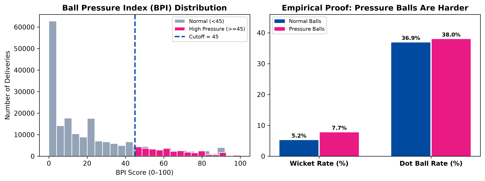
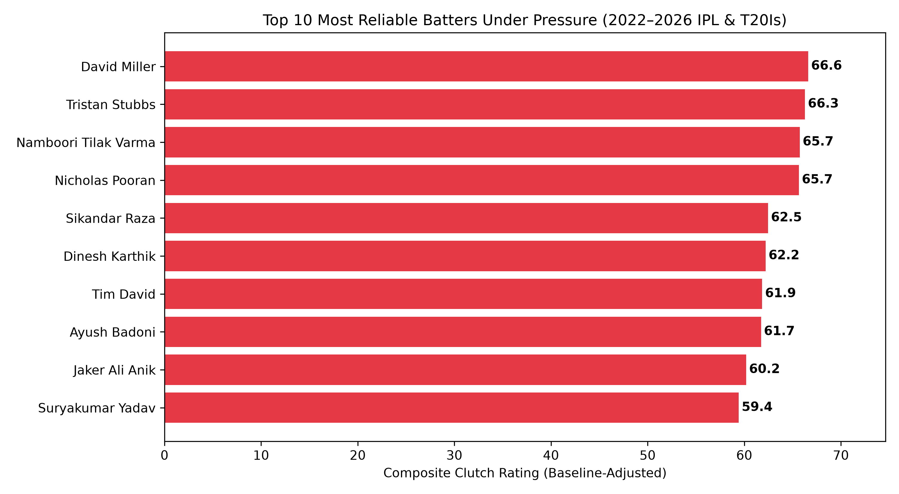
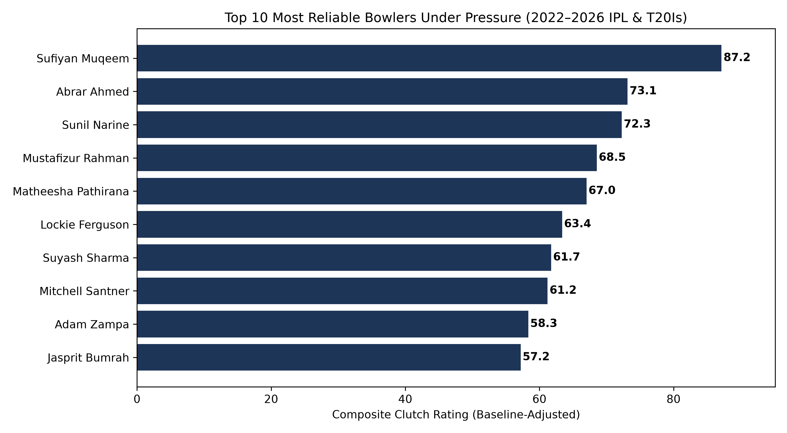
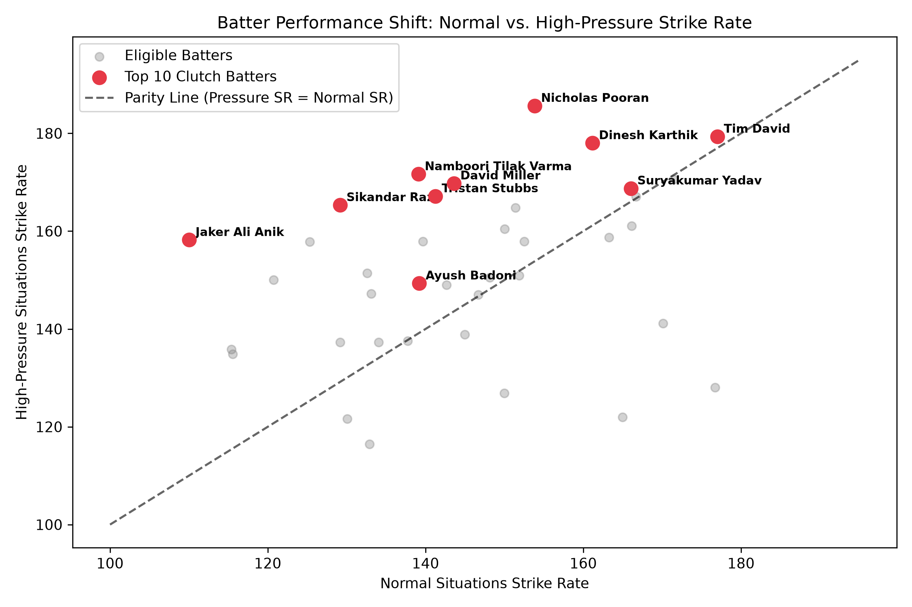
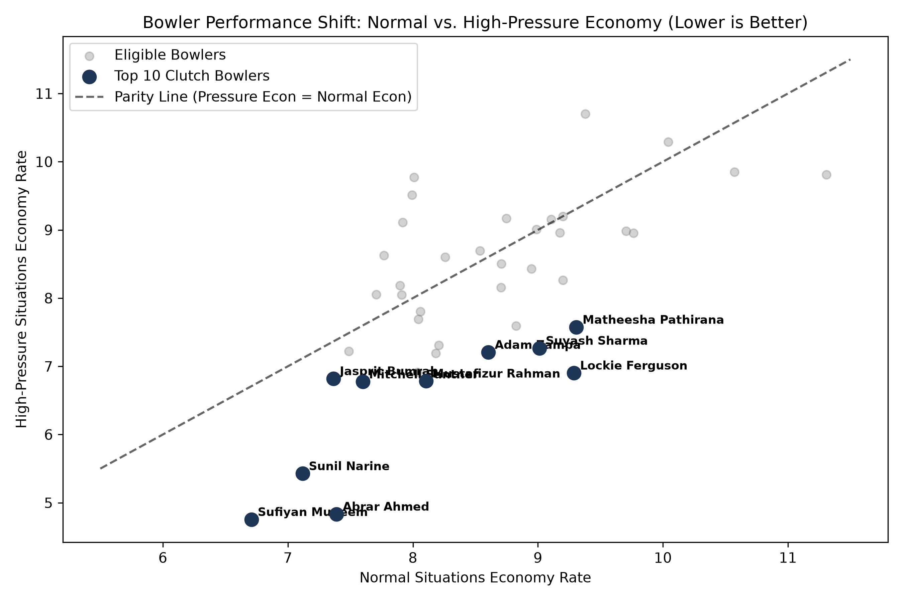

# T20 Clutch Performance & Pressure Analytics Engine
**Built for Rajasthan Royals' SupeRR Selector Season 2 (Round 1)**

A Python-based sports analytics pipeline that quantifies how batters and bowlers perform in high-leverage match situations compared to their normal baselines across **200,961+ deliveries** (2022–2026 IPL & T20Is).

---

## 1. Core Methodology

### Ball Pressure Index (BPI: 0–100 Scale)
To eliminate look-ahead bias, exact match state is reconstructed **before** each delivery using cumulative runs, legal deliveries, and wickets:
* **Wicket & Collapse Stress (0–40 pts):** Measures wickets fallen above expected trajectory $\left(\frac{\text{Legal Balls}}{\text{Max Balls}} \times 5\right)$, with an added collapse penalty at $\ge 5$ wickets down.
* **Scoring Rate & Chase Stress (0–40 pts):** Evaluates Required Run Rate (RRR) above $8.0$ RPO in 2nd innings (with DLS revised-target/over handling) and below-par run rates after Over 6 in 1st innings.
* **Death-Over & Knockout Leverage (0–28 pts):** Captures final-5-over pressure in close chases ($\text{RRR } 7.5\text{–}15.0$) and tournament knockout fixtures.
* **Garbage-Time Filter:** Excludes dead-rubber chases ($\text{RRR} > 22.0$ or $< 2.0$ RPO) so low-stakes stat-padding does not distort pressure samples.

### Empirical Validation
* **16.1% (32,375 deliveries)** cross the High-Pressure threshold ($\text{BPI} \ge 45.0$).
* Across the dataset, dismissal frequency jumps by **+47.9%** under high pressure (**7.75% per legal ball** vs. **5.24%** in normal play), validating that the index isolates genuinely harder game states.

### Composite Clutch Rating ($50 \pm 15$ Scale)
1. **Delivery-Level Impact:** Rewards boundaries, wickets, and dot-ball pressure while excluding wides from batter balls faced and run-outs from bowler wicket credit.
2. **Fair Context & Shrinkage:** Applies competition-tier weights (`IPL = 1.00`, `Top-10 T20Is = 0.80`, `Bilateral = 0.55`, `Associate = 0.40`), minimum sample cutoffs ($\ge 150$ pressure balls for batters, $\ge 180$ for bowlers), and **Empirical Bayes shrinkage** toward the global mean.
3. **Final Weighted Z-Score:**
   $$\text{Raw Score} = 0.60 \cdot Z(\text{Shrunk Impact}) + 0.25 \cdot Z(\text{Baseline Lift}) + 0.15 \cdot Z(\text{Match Consistency})$$

---

## 2. Key Results

| Rank | Top Batters Under Pressure | Clutch Rating | Pres SR (vs Norm) | Top Bowlers Under Pressure | Clutch Rating | Pres Econ (vs Norm) |
| :--- | :--- | :---: | :---: | :--- | :---: | :---: |
| **1** | David Miller | **66.6** | 169.8 (+26.2) | Sufiyan Muqeem | **87.2** | 4.76 (-1.95) |
| **2** | Tristan Stubbs | **66.3** | 167.2 (+25.9) | Abrar Ahmed | **73.1** | 4.83 (-2.55) |
| **3** | Namboori Tilak Varma | **65.7** | 171.7 (+32.6) | Sunil Narine | **72.3** | 5.43 (-1.69) |
| **4** | Nicholas Pooran | **65.7** | 185.6 (+31.8) | Mustafizur Rahman | **68.5** | 6.79 (-1.32) |
| **5** | Sikandar Raza | **62.5** | 165.3 (+36.2) | Matheesha Pathirana | **67.0** | 7.57 (-1.73) |

*(Full Top 10 tables, scatter comparisons, and methodology report available in [`SupeRR_Selector_Round1_Final.pdf`](SupeRR_Selector_Round1_Final.pdf).)*

---

## 3. Visual Highlights

### Ball Pressure Index (BPI) Empirical Validation

### Top 10 Batters & Bowlers Under Pressure
| Top 10 Batters | Top 10 Bowlers |
| :---: | :---: |
|  |  |

### Baseline vs. High-Pressure Performance Shift
| Batter Strike Rate Shift | Bowler Economy Rate Shift |
| :---: | :---: |
|  |  |

---

## 4. Tech Stack & Data Disclaimer
* **Tech Stack:** Python, Pandas, NumPy, Matplotlib (`PdfPages` automated reporting)
* **Data Note:** Raw ball-by-ball and match CSV datasets are proprietary to the Rajasthan Royals SupeRR Selector competition and are excluded from this repository.